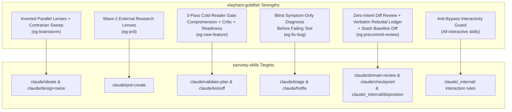

# Enhancement Plan: Integrating Elephant/Goldfish Patterns into `savviety-skills`

## Executive Summary & Architectural Comparison

[`elephant-goldfish`](file:///home/gary/repos/elephant-goldfish/README.md) implements Dave Rensin's **Elephant/Goldfish** pattern across five lifecycle stages (`eg-brainstorm`, `eg-prd`, `eg-new-feature`, `eg-fix-bug`, `eg-precommit-review`). Its core thesis is **deliberate context asymmetry**:
- **The Elephant** is the primary session holding full conversational context, institutional memory, and hypotheses.
- **The Goldfish** is a stateless subagent given *only* a specific artifact (a seed, symptom+repro, design doc, or raw diff) with **zero** conversational framing or intent leakage. Disagreement or confusion from a cold reader is treated as the cheapest signal of anchoring or under-specification.

By contrast, [`savviety-skills`](file:///home/gary/repos/savviety-skills/README.md) has a much more mature **structural and semantic governance pipeline** (`ONTOLOGY.md`, `AERS.md`, task-graph plans in [`_internal/plan-format`](file:///home/gary/repos/savviety-skills/claude/_internal/plan-format/SKILL.md), 11-domain [`domain-review`](file:///home/gary/repos/savviety-skills/claude/domain-review/SKILL.md), cross-model [`review-adversarial`](file:///home/gary/repos/savviety-skills/claude/review-adversarial/SKILL.md), and deterministic [`validate-plan`](file:///home/gary/repos/savviety-skills/claude/validate-plan/SKILL.md)). However, several `savviety-skills` workflows either run in a single conversational context (risking self-anchoring) or pass the author's stated intent to reviewers.

Rather than importing `eg-*` as competing top-level skills, we should **infuse the highest-leverage Elephant/Goldfish mechanisms into existing `savviety-skills` skills and `_internal/` contracts**.

---

## Key Gaps & Recommendations

---

### 1. Blind Goldfish Diagnosis in `/triage` and `/hotfix`
* **Source:** [`eg-fix-bug.md`](file:///home/gary/repos/elephant-goldfish/claude/commands/eg-fix-bug.md#L56-L88)
* **Current State in `savviety-skills`:** [`claude/triage/SKILL.md`](file:///home/gary/repos/savviety-skills/claude/triage/SKILL.md#L57-L95) and [`claude/hotfix/SKILL.md`](file:///home/gary/repos/savviety-skills/claude/hotfix/SKILL.md#L63-L81) investigate bugs in a single session context. Once the main agent forms an initial hypothesis, it is prone to confirmation bias.
* **Recommendation:**
  1. **Hidden Hypothesis + Blind Goldfish Check in `/triage`:** After Step 3 (Reproduce/Trace) in [`claude/triage/SKILL.md`](file:///home/gary/repos/savviety-skills/claude/triage/SKILL.md#L57-L77), have the primary session record its candidate root cause privately, then spawn a fresh `Explore` / `general-purpose` subagent given **only** the symptom and reproduction steps (explicitly withholding the elephant's hypothesis).
  2. **Convergence/Divergence Reporting:** Add a `Diagnosis Agreement` field to the Triage Report ([`claude/triage/SKILL.md`](file:///home/gary/repos/savviety-skills/claude/triage/SKILL.md#L149-L179)) documenting whether the blind subagent converged on the same `file:line` and falsifying evidence, or diverged (forcing re-investigation).
  3. **Failing-Test-First Enforcement in `/hotfix`:** Update [`claude/hotfix/SKILL.md`](file:///home/gary/repos/savviety-skills/claude/hotfix/SKILL.md#L74-L81) Step 4 so the regression test must be written and **observed failing for the expected reason** *before* applying the fix (matching `eg-fix-bug` Step 3), with an explicit triviality gate for copy/config/version-bump changes.

---

### 2. Cold-Reader Comprehension & "First-Pass Implementer" Readiness Gate
* **Source:** [`eg-new-feature.md`](file:///home/gary/repos/elephant-goldfish/claude/commands/eg-new-feature.md#L93-L230) (Pass A: Comprehension, Pass B: Critic, Pass C: Readiness)
* **Current State in `savviety-skills`:**
  * [`claude/validate-plan/SKILL.md`](file:///home/gary/repos/savviety-skills/claude/validate-plan/SKILL.md) runs deterministic structural checks (`validate_plan.py`) and single-context prose checks.
  * [`claude/spec-review-adversarial/SKILL.md`](file:///home/gary/repos/savviety-skills/claude/spec-review-adversarial/SKILL.md) runs Skeptic, Coherence, Semantic, and Devil's Advocate lenses, but lacks a **Cold-Reader Paraphrase** check and a **First-Pass Implementer ("No Follow-Up Questions Allowed")** check.
* **Recommendation:**
  1. **Add Cold-Reader Paraphrase & Implementability Checks to `/spec-review-adversarial` (or `/prd-validate`):**
     * **Cold-Reader Comprehension Pass:** Spawn a stateless subagent with *only* the `PRD.md`/`AERS.md` (no chat context) asked to paraphrase "What this feature does" and "How the existing system works per the doc" in 2–5 sentences. If the cold reader misstates the intent, the spec is ambiguous regardless of its structural score.
     * **Readiness ("Zero Follow-Up Questions") Pass:** Ask a fresh implementer subagent: *"Imagine you must implement this in one pass with zero follow-up questions allowed. List every question you would have to ask the author before shipping."*
  2. **Optional `--deep` (Goldfish) Mode in `/validate-plan` or `/kickoff`:** Before launching execution in [`claude/kickoff/SKILL.md`](file:///home/gary/repos/savviety-skills/claude/kickoff/SKILL.md#L153-L161), offer or run a stateless Readiness Goldfish against the plan + target file surfaces to catch hallucinated file paths/signatures before code edits begin.

---

### 3. Divergent Goldfish Lenses + Contrarian Sweep in `/ideate`
* **Source:** [`eg-brainstorm.md`](file:///home/gary/repos/elephant-goldfish/claude/commands/eg-brainstorm.md#L58-L187)
* **Current State in `savviety-skills`:** [`claude/ideate/SKILL.md`](file:///home/gary/repos/savviety-skills/claude/ideate/SKILL.md) is single-threaded interactive shaping (`idea`, `ba`, `tech`), while [`claude/design-twice/SKILL.md`](file:///home/gary/repos/savviety-skills/claude/design-twice/SKILL.md) uses parallel agents strictly for module/API signatures. There is no parallel multi-lens concept generator for product/strategy ideation.
* **Recommendation:**
  1. **Add a `--divergent` (or `brainstorm`) flow to `/ideate`:**
     * Draft and confirm a structured **Seed** (The thought, Underlying need, Constraints, Success criteria, Out of scope) before spawning agents.
     * Spawn 3–5 parallel stateless subagents with isolated lenses (*Technical/Architectural*, *Business/Market*, *UX*, *Contrarian/Pre-mortem*, *Prior Art/Web*, *Adjacent/Lateral*).
     * Run the **Contrarian Outsider Sweep** ([`eg-brainstorm.md`](file:///home/gary/repos/elephant-goldfish/claude/commands/eg-brainstorm.md#L146-L154)): pass the seed + deduplicated concepts to one final goldfish asking *"What did they ALL miss? What assumption did every lens share?"*
     * Synthesize into `WHAT THE GOLDFISH AGREED ON` vs. `WHAT THEY DISAGREED ON` before handing off to `/prd-create` or `/goal`.

---

### 4. Parallel External Research Wave in `/prd-create`
* **Source:** [`eg-prd.md`](file:///home/gary/repos/elephant-goldfish/claude/commands/eg-prd.md#L58-L180)
* **Current State in `savviety-skills`:** [`claude/prd-create/SKILL.md`](file:///home/gary/repos/savviety-skills/claude/prd-create/SKILL.md#L122-L150) has an excellent Step 1 brownfield codebase seed (`/audit-existing` + `references/codebase-seed.md`), but conducts zero external/prior-art/compliance/scale research and runs its codebase scan sequentially unless delegated.
* **Recommendation:**
  1. **Parallelize Step 1 Codebase Grounding:** In brownfield repos, dispatch two concurrent `Explore` subagents (Existing Surfaces vs. Architecture & Conventions) to reduce latency and context bloat in the main interview thread.
  2. **Optional Research Wave (`--research` flag or Step 0 prompt in `/prd-create`):** After UoD boundary & critical gaps are framed, allow spawning parallel research subagents across *Market/Prior Art*, *Technical Patterns*, *UX Precedent*, and *Compliance/Scale*, feeding cited findings into `PRD.md` (`Risks and Assumptions`, `Non-functional Requirements`, and a new optional `Sources & References` block).

---

### 5. Intent-Free Review Option, Verbatim Rebuttal Ledger, and Baseline Lint Stash
* **Source:** [`eg-precommit-review.md`](file:///home/gary/repos/elephant-goldfish/claude/commands/eg-precommit-review.md#L24-L184)
* **Current State in `savviety-skills`:**
  * Both [`claude/domain-review/SKILL.md`](file:///home/gary/repos/savviety-skills/claude/domain-review/SKILL.md#L130) and [`claude/review-adversarial/SKILL.md`](file:///home/gary/repos/savviety-skills/claude/review-adversarial/SKILL.md#L126-L128) pass the author's stated intent (`pr_description` / stated intent) to reviewers. While useful for alignment, intent framing can anchor reviewers into excusing bugs because "that's what the author meant to do."
  * [`claude/checkpoint/SKILL.md`](file:///home/gary/repos/savviety-skills/claude/checkpoint/SKILL.md#L155) notes that pre-existing failures shouldn't block, but gives no mechanical recipe to prove an error is pre-existing.
* **Recommendation:**
  1. **Cold-Diff (No-Intent) Mode or Worker in `/domain-review`:** Add an option (or rule for the `correctness` and `security` domain workers) to review the diff *without* author intent commentary, plus a stateful re-invocation addendum (`Previous round's fixes: ... Verify each fix is correct and look for regressions introduced by the fixes`) and a **same-location oscillation breaker** (halt and escalate if a new finding lands within ~10 lines of a previously fixed line, per [`eg-precommit-review.md`](file:///home/gary/repos/elephant-goldfish/claude/commands/eg-precommit-review.md#L161)).
  2. **Tighten `disagree-with-evidence` in `_internal/disposition`:** Incorporate the four strict rebuttal categories from [`eg-precommit-review.md`](file:///home/gary/repos/elephant-goldfish/claude/commands/eg-precommit-review.md#L130) into [`claude/_internal/disposition/SKILL.md`](file:///home/gary/repos/savviety-skills/claude/_internal/disposition/SKILL.md#L77-L80):
     * *(a)* Not a bug because `X` (where `X` is visible in diff/codebase, cited by `file:line`)
     * *(b)* Out of scope — diff does not touch that area
     * *(c)* Intentional trade-off documented in `file:line` or `CLAUDE.md` / `ONTOLOGY.md`
     * *(d)* User explicitly requested in this session (must quote user's words verbatim)
     * Explicitly ban vague intent claims (*"I meant to do that"*) and require verbatim surfacing of all `disagree-with-evidence` rationales in the final user-facing report.
  3. **Safe `git stash create` Baseline Recipe in `/checkpoint`:** Add the non-destructive `git stash create` baseline-diff snippet from [`eg-precommit-review.md`](file:///home/gary/repos/elephant-goldfish/claude/commands/eg-precommit-review.md#L31-L42) (and a safer `git worktree` alternative) to [`claude/checkpoint/SKILL.md`](file:///home/gary/repos/savviety-skills/claude/checkpoint/SKILL.md) so agents can mechanically prove whether a lint/typecheck error was pre-existing on `default_branch`.
  4. **Test-Modification Guard:** Add the rule from [`eg-precommit-review.md`](file:///home/gary/repos/elephant-goldfish/claude/commands/eg-precommit-review.md#L53): if an existing test fails during implementation/checkpoint, the agent must **not** silently rewrite the test to pass unless a task or reviewer explicitly confirms the expected behavior changed.

---

### 6. Anti-Bypass Interactivity Guard & Structured Two-Step Refinement
* **Source:** [`eg-brainstorm.md`](file:///home/gary/repos/elephant-goldfish/claude/commands/eg-brainstorm.md#L12-L21), [`eg-prd.md`](file:///home/gary/repos/elephant-goldfish/claude/commands/eg-prd.md#L14-L23)
* **Current State in `savviety-skills`:** Interview skills ([`prd-create`](file:///home/gary/repos/savviety-skills/claude/prd-create/SKILL.md#L87-L94), [`prd-validate`](file:///home/gary/repos/savviety-skills/claude/prd-validate/SKILL.md#L283), [`grill-me`](file:///home/gary/repos/savviety-skills/claude/grill-me/SKILL.md), [`ideate`](file:///home/gary/repos/savviety-skills/claude/ideate/SKILL.md)) check for non-interactive CI contexts, but when a user has a global system reminder or personal instruction saying *"don't ask clarifying questions / work autonomously"*, the LLM often skips the interview questions inside an explicitly invoked interview skill.
* **Recommendation:**
  1. **Add the Explicit Interactivity Override Clause** to `_internal/aers-readiness` (and interactive skills `/prd-create`, `/prd-validate`, `/ideate`, `/grill-me`, `/goal`): invoking an interactive interview skill is the user's explicit consent for structured questions and overrides ambient "do not pause for clarifying questions" directives unless the user passes an explicit flag in the invoking turn.
  2. **Two-Step Scoped Refinement Pattern:** When a user chooses "Refine" on a generated seed, UoD boundary, or PRD draft, use a multi-select question *first* to ask **which specific field/section** needs revision before prompting for free-form text (as in [`eg-brainstorm.md` Q4.5](file:///home/gary/repos/elephant-goldfish/claude/commands/eg-brainstorm.md#L85-L98) and [`eg-prd.md` Q-refine](file:///home/gary/repos/elephant-goldfish/claude/commands/eg-prd.md#L255-L263)).

---

## Proposed Implementation Roadmap (Phased)

### Phase 1: Internal Contracts & Governance Hardening (`claude/_internal/` & `shared/`)
1. **[`claude/_internal/disposition/SKILL.md`](file:///home/gary/repos/savviety-skills/claude/_internal/disposition/SKILL.md)**
   - Add the 4-category evidence rule for `disagree-with-evidence`, forbid unverified *"I meant to do that"* claims, require verbatim rebuttal output in final reports, and add the same-location (~10 lines) oscillation escalation rule.
2. **[`claude/_internal/aers-readiness/SKILL.md`](file:///home/gary/repos/savviety-skills/claude/_internal/aers-readiness/SKILL.md)**
   - Add the **Interactivity Override Clause** (explicit invocation of an interview skill overrides ambient no-stopping system reminders) and the **Two-Step Scoped Refinement** interaction rule.

### Phase 2: Review, Verification & Bug-Fix Workflows
3. **[`claude/triage/SKILL.md`](file:///home/gary/repos/savviety-skills/claude/triage/SKILL.md) & [`claude/hotfix/SKILL.md`](file:///home/gary/repos/savviety-skills/claude/hotfix/SKILL.md)**
   - Add the **Blind Goldfish Diagnosis** step to `/triage` (spawn fresh subagent with symptom + repro only; compare against primary hypothesis; report convergence/divergence).
   - Enforce failing-test-before-fix and test-failure-reason verification in `/hotfix`, plus a triviality fast-path for non-logic changes.
4. **[`claude/checkpoint/SKILL.md`](file:///home/gary/repos/savviety-skills/claude/checkpoint/SKILL.md)**
   - Add the non-destructive baseline-diff check for distinguishing new vs. pre-existing lint/typecheck errors.
   - Add the **Test-Modification Guard** (do not silently rewrite existing failing tests without verifying expected behavior change).
5. **[`claude/domain-review/SKILL.md`](file:///home/gary/repos/savviety-skills/claude/domain-review/SKILL.md)**
   - Strip author intent framing from `correctness` and `security` worker dispatches (or add `--cold` mode) so workers judge what the code *does*, not what the author *hoped* it would do.
   - Add the stateful multi-round ledger format and oscillation guard when running iterative review-fix loops.

### Phase 3: Ideation, PRD Authoring & Spec Readiness
6. **[`claude/spec-review-adversarial/SKILL.md`](file:///home/gary/repos/savviety-skills/claude/spec-review-adversarial/SKILL.md)**
   - Add **Cold-Reader Comprehension** (paraphrase check) and **First-Pass Implementer Readiness** ("zero follow-up questions allowed") to the specification review lenses.
7. **[`claude/ideate/SKILL.md`](file:///home/gary/repos/savviety-skills/claude/ideate/SKILL.md)**
   - Add an optional parallel divergent-goldfish mode (`--divergent` / `brainstorm`): Seed confirmation → 3–5 isolated lens subagents → Contrarian outsider sweep ("what did they all miss?") → Convergence/Divergence synthesis.
8. **[`claude/prd-create/SKILL.md`](file:///home/gary/repos/savviety-skills/claude/prd-create/SKILL.md)**
   - Parallelize Step 1 brownfield codebase discovery using concurrent read-only subagents.
   - Add optional external research lens dispatch (`--research`) to populate prior art, technical patterns, and compliance/performance budgets with inline citations.

### Phase 4: Cross-Platform Sync (`codex/`, `copilot/`, `kimi/`, `hermes/`)
9. Propagate updated shared contracts (`shared/workflow-contracts/`) and corresponding skill/agent prompts to `codex/`, `copilot/`, `kimi/`, and `hermes/`, and run `bin/check-workflow-syntax` and `jq` validation per [`CLAUDE.md`](file:///home/gary/repos/savviety-skills/CLAUDE.md).

---

## Verification Plan (When Implemented)
- Run structural and syntax checks from [`CLAUDE.md`](file:///home/gary/repos/savviety-skills/CLAUDE.md):
  - `find claude -name "*.mjs" -print0 | xargs -0 bin/check-workflow-syntax && jq empty manifest.json`
  - `jq empty claude/settings.template.json && jq empty manifest.json`
- Run existing test suite under [`tests/`](file:///home/gary/repos/savviety-skills/tests).
- Verify self-hosted overlays in `.claude/skills/` remain in sync with `claude/`.
